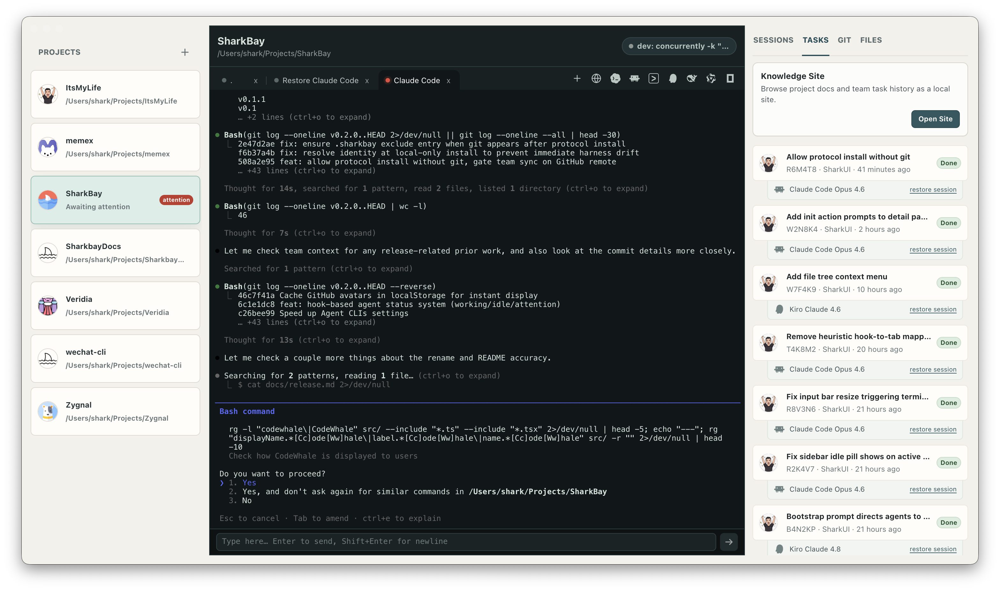

<p align="center">
  
</p>

<h1 align="center">SharkBay</h1>

<p align="center">
  <strong>GitHub-native workbench for multi-agent development</strong>
</p>

<p align="center">
  <a href="https://sharkbay.xyz">sharkbay.xyz</a>
</p>

<p align="center">
  
</p>

## Install SharkBay

### macOS desktop

Download [SharkBay 0.3.14](https://github.com/SharkUI/SharkBay/releases/tag/v0.3.14)
for macOS 13 Ventura or later on Apple Silicon (arm64). You can also install
the app with Homebrew:

```bash
brew install --cask SharkUI/tap/sharkbay
```

### Upgrade from 0.3.13 or earlier

Install and open [0.3.14](https://github.com/SharkUI/SharkBay/releases/tag/v0.3.14)
first. Your terminals can keep running while the update installs and the new
Runtime downloads in the background. When SharkBay says the Runtime is ready,
finish active work, restart your Mac, and open SharkBay again. Your projects
and settings carry over. The Runtime includes its own Node.js.

After the migration, SharkBay can offer the 1.0 desktop update when it becomes
available. Keep the 0.3.14 download link for a manual upgrade if an older app
no longer offers it automatically.

### Standalone Runtime + WebUI

The standalone npm package is designed for macOS and Linux on x64 or arm64
with Node.js 22.12+ in the 22.x series. Until it is available on npm, follow the
[Runtime packaging instructions](docs/release.md#runtime-and-webui) to install
it from a local tarball. Once published, install and start it with:

```bash
npm install -g @sharkbay/runtime
sharkbay serve
```

Open `http://127.0.0.1:17777/`. Use `sharkbay service enable` to run it in the
background and start it at login, or `sharkbay service disable` to stop it and
disable login startup. Use `--lan` with `serve` or `service enable` to make the
workbench available on a trusted local network. Reachable devices on that
network can operate host projects and terminals.

See the [changelog](CHANGELOG.md#0314--2026-11-25) for release details.

## Features

### Shared Runtime and Browser Access

The macOS app and WebUI connect to one local Node runtime. One client controls each terminal while others observe. Closing the desktop client leaves sessions running, and you can take control from another connected client.

The WebUI adapts to phones and tablets with full-screen project navigation, touch terminal keys, and preserved input drafts across reconnects.

The npm CLI listens on loopback at port `17777` by default. With `--lan`, open `http://<host-ip>:17777/` on another device on the trusted network. The older bundled Runtime listens on all IPv4 interfaces by default. Host and Origin checks apply on both paths.

### Multi-Agent Support

Launch and manage multiple AI coding agents from one workspace.

Supported agents: **Claude Code** · **Codex** · **Gemini** · **Kiro** · **Reasonix** · **Qwen** · **OpenCode** · **Cursor CLI**

### Agent Status

Real-time hook-based status indicators (working/stopped/approval) — see what each agent is doing without switching terminals.

### Island Overlay

macOS Dynamic Island–style floating notch displaying live agent session states with animated shark mark and glow ring — always visible, click-through transparent areas.

### Appearance

Theme, color scheme (526 options), and font customization — including CJK fonts with instant preview and keyboard navigation.

### Bottom Prompt Input

Dedicated input bar at the bottom of agent terminals for composing prompts with comfortable editing, slash-command forwarding, and project-scoped history.

### Multi-Project Workspace

Manage local projects in a unified sidebar. Add, remove, and switch between repositories instantly.

Create a new branch worktree from a project context menu and register it as a SharkBay project in one step.

### Terminal Tabs

Open a new shell tab with Cmd+T, keep per-project tabs alive, and reorder terminal tabs by dragging.

### GitHub-Compatible Task Protocol

Project-local `.sharkbay` harness with Markdown task records, synced through a GitHub remote branch. Works with any agent that reads files.

### Sessions

Browse all agent sessions per project — see model versions, auto-generated titles, and restore any previous session with one click.

### Team Context Sharing

Task records provide shared context across agents and team members, synced through a GitHub remote branch.

### Integrated Browser

Embedded browser tabs for local dev servers and web URLs, right next to your terminals — no app-switching.

### Dev Environment Quick Launch

Auto-discovers `dev` / `dev:*` scripts from `package.json` and Python CLI web commands. Start and stop services without leaving the workbench.

### Git at a Glance

Branch name, dirty state, changed files, and recent reflog activity — all visible in the project panel without running commands.

### Quick File Editor

Built-in CodeMirror editor with syntax highlighting for 20+ languages. Open, edit, and save project files in tabs — Cmd+S to save, dirty state tracking, 5 MB file support.

## Documentation

- [Product notes](docs/product.md)
- [Architecture](docs/architecture.md)
- [Development guide](docs/development.md)
- [Testing](docs/testing.md)
- [Release and packaging](docs/release.md)
- [Task Protocol](docs/tasks.md)
- [Agent guide](docs/agents.md)
- [Roadmap](docs/roadmap.md)

## Tech Stack

Electron · React · TypeScript · Vite · xterm · @lydell/node-pty · CodeMirror

## Development Requirements

- macOS
- Node.js >= 22.12
- Git
- `gh` CLI (only for team context sync)

Coding-agent CLIs use your existing local installations and accounts. GitHub remains the identity and collaboration system for task-context sync.

## Development

```bash
npm install
npm run dev
```

## Checks

```bash
npm run typecheck
npm test
npm run build
```

## Packaging

```bash
npm run pack    # unpacked app for smoke testing
npm run dist    # distributable macOS artifacts in release/
```

## License

SharkBay is licensed under the GNU General Public License v3.0 only. See [LICENSE](LICENSE).
